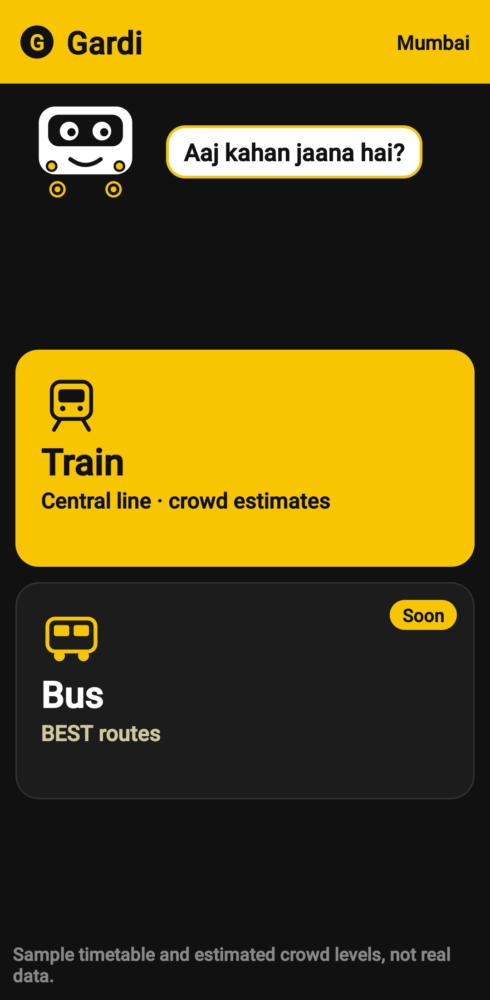
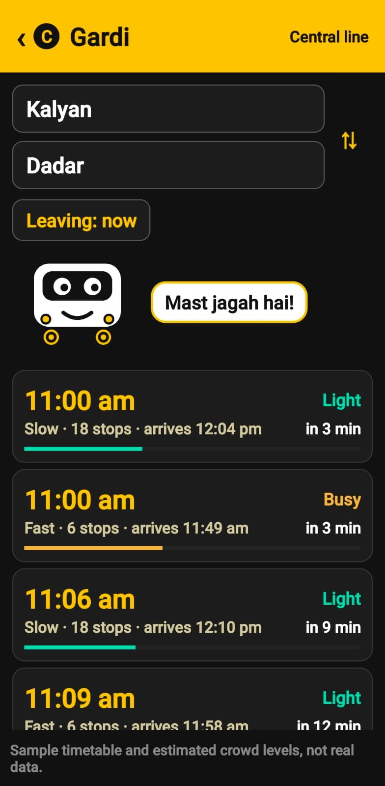
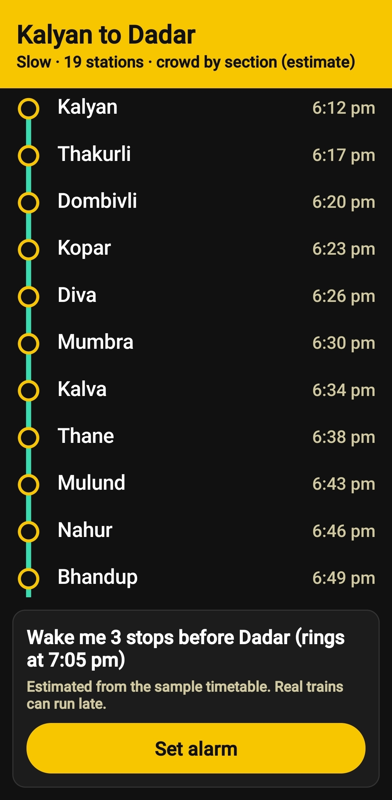
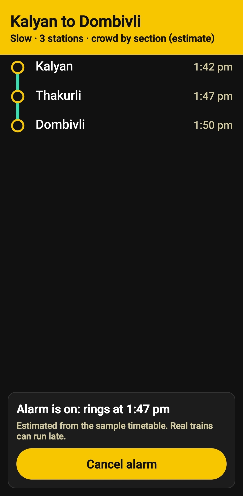
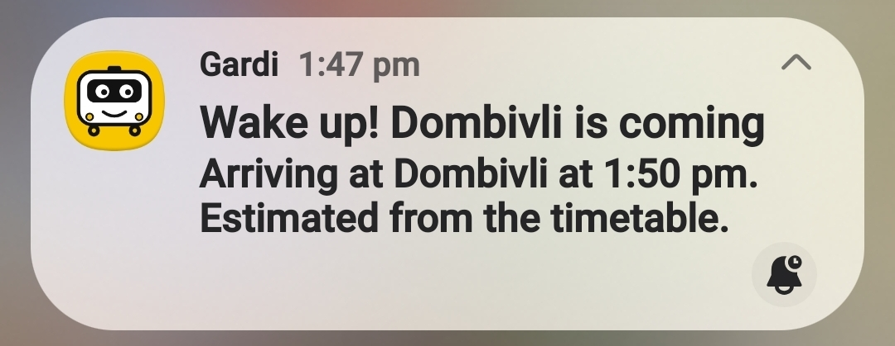
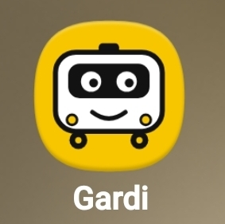

# Gardi: Mumbai local train companion

A Java Android app for the Mumbai local train (Central line). It shows the next trains between two stations, estimates how crowded each train will be, draws a crowd heat line for the trip, and can wake you up a few stops before your station.

> **Note:** the timetable is sample data and the crowd levels are estimates from a formula. Gardi is a learning project, not an official railway app.

## Screenshots

<table>
  <tr>
    <td></td>
    <td></td>
    <td></td>
  </tr>
  <tr>
    <td align="center">Train or Bus</td>
    <td align="center">Next trains with crowd estimate</td>
    <td align="center">Crowd heat line</td>
  </tr>
  <tr>
    <td></td>
    <td></td>
    <td></td>
  </tr>
  <tr>
    <td align="center">Station alarm set</td>
    <td align="center">Alarm notification</td>
    <td align="center">App icon</td>
  </tr>
</table>

## Features

- **Animated intro:** the train rolls in, the dashed track scrolls and the letters G-A-R-D-I flip in like a station board.
- **Train or Bus choice:** Train is ready. Bus (BEST routes) is a coming-soon screen.
- **Trip planner:** pick From and To, see the next trains with fast or slow, number of stops, arrival time and a countdown. **Leaving: now** lets you pick another time, such as the evening rush.
- **Crowd estimate:** every train gets Light, Busy or Packed with a meter. The cartoon mascot changes mood and speech bubble with the next train's crowd.
- **Crowd heat line:** tap a train to see its stations as a line coloured by crowd level, drawn station by station.
- **Station alarm:** rings a few stops before your destination.
- **Works offline:** no internet needed.

## How the crowd estimate works

A formula, not live data. Morning rush peaks near 9:00 towards Dadar and evening rush near 18:48 away from it.

- Score = 18 + 72 x load, where load blends the two rush-hour peaks depending on direction
- Fast trains add 6, hub stations (Kalyan, Thane, Ghatkopar, Kurla, Dadar) add 8, and weekends multiply by 0.65
- Light is under 40, Busy is 40 to 69, Packed is 70 and over

The formula is in `CrowdEngine.java`.

## Station alarm

1. Open a trip and tap **Set alarm**.
2. Allow **Notifications**, and on newer Android versions allow **Alarms & reminders** for Gardi when asked.
3. The alarm rings 3 stops before your destination (or at the next stop on short trips) with the alarm sound, vibration and a notification that repeats until you open it.

It uses the timetable, so real delays are not counted. Press and hold **Set alarm** to test it: it rings in 1 minute.

## Tech stack

- Java, Android SDK (minimum 24, target and compile 34), Gradle with Android Gradle plugin 8.5.2
- AppCompat, Material Components, RecyclerView
- Custom Canvas views for the mascot, the heat line and the scrolling track
- ValueAnimator and ViewPropertyAnimator for the intro and screen animations
- AlarmManager `setAlarmClock` plus a notification on an alarm-sound channel
- Adaptive launcher icon with a themed (monochrome) version

## Run it

1. Open the folder that contains `settings.gradle` in Android Studio and let Gradle sync (choose JVM 21 if asked).
2. Run on a phone or an emulator with Android 7.0 or newer.

## Project structure

| File | What it does |
|---|---|
| `SplashActivity` | Animated intro, then opens the Train or Bus screen |
| `ModeActivity` | Train and Bus tiles |
| `BusActivity` | Coming-soon screen for BEST routes |
| `MainActivity`, `TrainAdapter` | Planner: stations, time chooser, mascot, list of trains |
| `TripActivity` | Heat line for one train and the alarm panel |
| `Timetable`, `Train` | Sample timetable and trip search |
| `CrowdEngine` | Crowd score, level, label and colour |
| `MascotView`, `HeatLineView`, `TrackView` | Custom drawn views and animations |
| `AlarmHelper`, `AlarmReceiver` | Sets, cancels and rings the station alarm |

## Limitations

- The timetable is generated in code for the Central line (Kalyan to Dadar and back), not the real railway timetable.
- Crowd levels are estimates, not live data.
- The alarm is based on the timetable, not GPS, and it is cancelled if the phone restarts.

## Roadmap

- Real timetable import (CSV to a Room database)
- GPS station alarm with real station coordinates
- Home-screen widget with the next train for a saved route
- BEST bus routes
- Marathi and Hindi

Built by Sujal Tambe.
